# AveritA 的 DSH 主题灵感集

[DeepSeek Harness](https://github.com/deepseek-ai/dsh) 的主题。

**一个轻量主题插件，分享出来希望给大家提供一些个性化专属自己的DSH的灵感~可以随意取用/魔改❤**

推荐配套字体：

正文："Source Serif 4", "霞鹜文楷"

代码："Hurmit Nerd Font Mono Light", "Microsoft YaHei"

| 主题 | 浅色实机 | 深色实机 |
|---|---|---|
| 昼雾 · 靛夜 | <a href="preview/shots-new/a-l.png">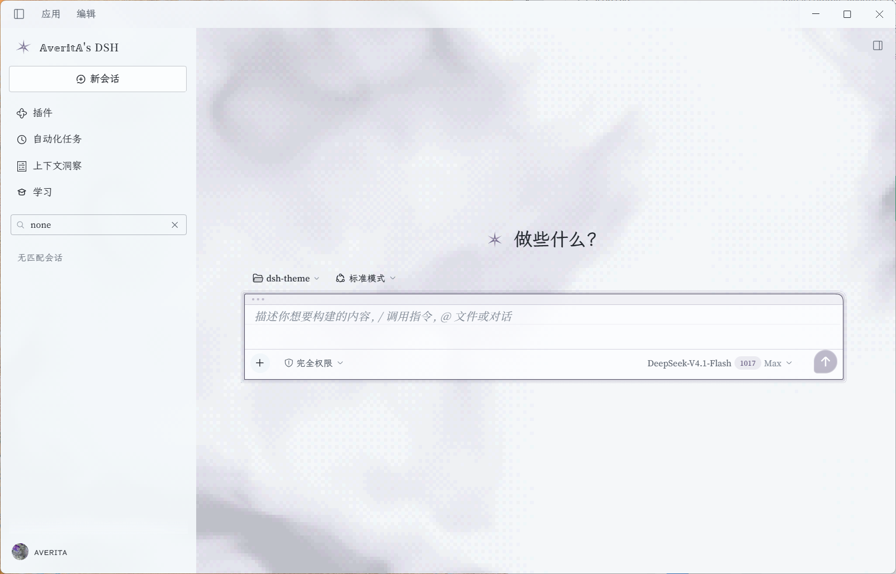</a> | <a href="preview/shots-new/a-d.png">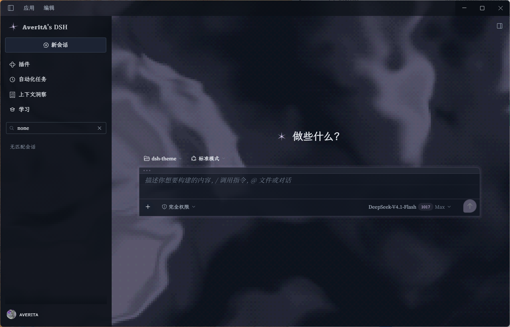</a> |
| 冷晨 | <a href="preview/shots-new/b-l.png">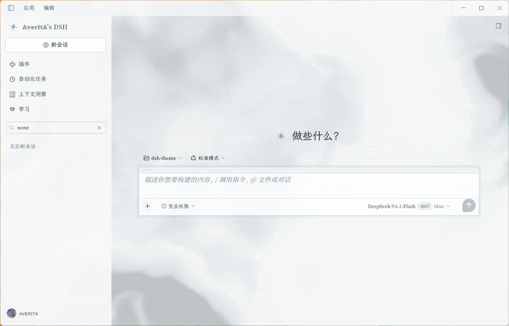</a> | <a href="preview/shots-new/b-d.png">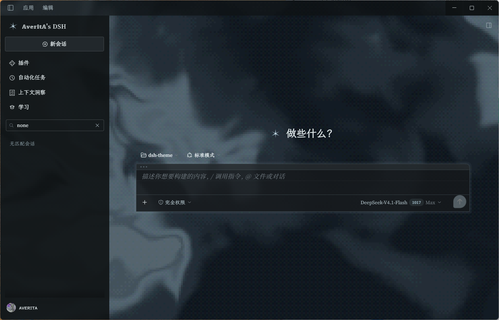</a> |
| 暮玫瑰 | <a href="preview/shots-new/c-l.png">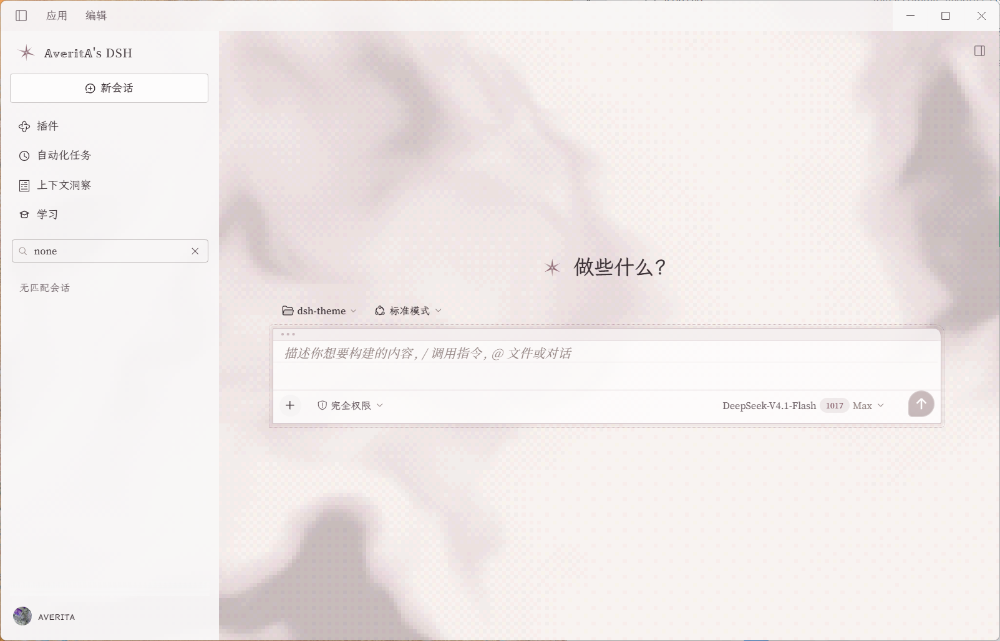</a> | <a href="preview/shots-new/c-d.png">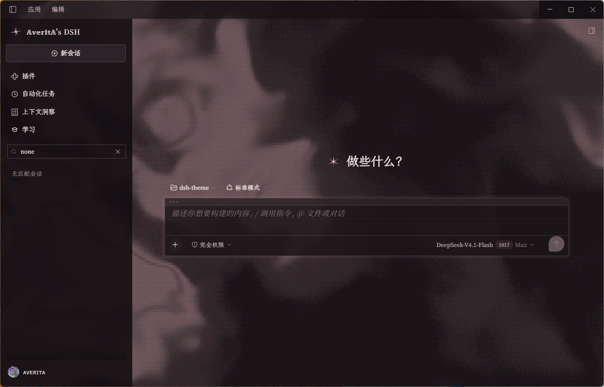</a> |
| 暮紫 | <a href="preview/shots-new/d-l.png">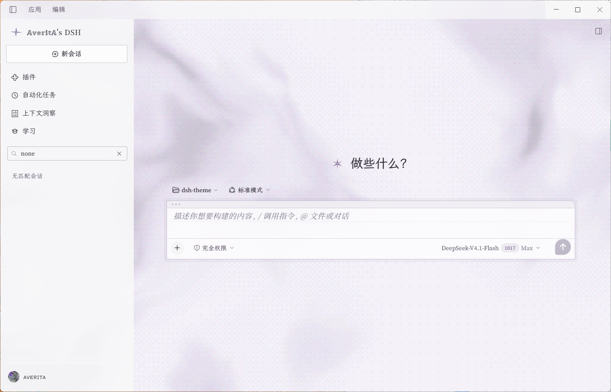</a> | <a href="preview/shots-new/d-d.png">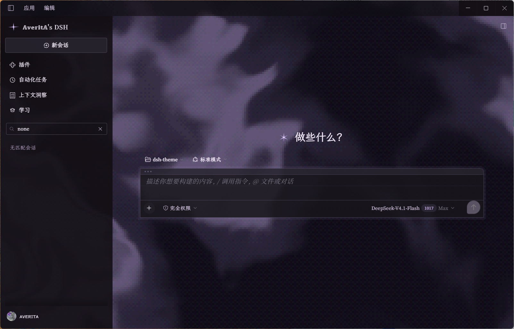</a> |

> DSH 0.2.1-rc.3 · Windows 实机；四套主题 × 浅 / 深，侧栏会话列表用搜索框过滤（none）后截的。`preview/` 下另有近似壳预览图，只用来量比例。

---

四套 DSH 主题的宿主插件。背景二选一：**点阵**（圆点 / 方块 / 字符 / 字符墙，缩放 / 浓淡 / 动效 / 呼吸下限可调）或**流光**（移植个人站的域扭曲 fbm 场，默认从当前主题取色，另有四套固定色板，缩放 / 浓淡可调，明暗默认反转：浅色下白做底、深色只落在光带上）。另有星标、位移动效与纸品装饰（用户消息 / 输入框）；输入框背后的底衬默认去掉（背景透到输入框后），可在「设置 → 主题 → 输入框底衬」开回 DSH 的渐隐；左上角 logo 右侧的字标可在设置里改，留空只留星标；新会话首屏也换成同一颗星，标题可自定义（「预览版」徽章隐藏）。**设置 → 主题**里即时切换，选择存在 localStorage。

| 主题 | 方向 | 数据 |
|---|---|---|
| `averita` 昼雾 · 靛夜 | 断章雾面纸 / 首页靛夜（原主题） | `src/tokens.js` |
| `coldmorning` 冷晨 | 冷灰绿晨雾，亮部偏青 | `src/themes/coldmorning.js` |
| `duskrose` 暮玫瑰 | 暖玫瑰纸 / 暮紫褐夜色 | `src/themes/duskrose.js` |
| `duskpurple` 暮紫 | 淡紫纸 / 暮紫夜色，对应流光「暮紫」 | `src/themes/duskpurple.js` |

- **令牌**：每套 205 个，浅/深成对 —— 128 个语义/语法令牌 + 77 个静态色板阶（`--dsw-static-*`，图标、状态点、diff、插画在用）；主题变量只有 `--av-space` / `--av-dot` / `--av-mark` 三枚。
- **切换**：`overrideTokens` 换令牌图层 + `html[data-av-theme]` 换 CSS 变量，不重装、不重启。
- **品牌位**：`sidebar.brand.mark` / `sidebar.brand.name` 两个 single slot，priority `-1`（官方在 0，数值低者渲染）——卸载即回退。星标是 32px 三轴正交六芒星；字标默认衬线 `AveritA's DSH`，可在**设置 → 主题 → 品牌字标**里自定义，留空只显示星标。新会话首屏用 `conversation.hero.brand.mark` 换同一颗星（34px），标题走 `--av-hero-text`，见[新会话首屏](#新会话首屏)。
- **背景与细节**：点阵是 `src/components/dots/style.css` 里的一层 fixed 伪元素，不跑逐帧；流光是一层 WebGL2 画布（`src/flow.js`，构建时内联），1/5 分辨率、30fps，切到流光才创建；两者互斥。品牌星是 6 支 SVG，约 30fps 重画。
- **UI 动效**：`--ds-transition-*` 180/120ms + 柔出曲线；位移动效：会话切换上浮 6px、会话行 hover 横移 2px、按钮按下 0.5px、最后一条回复上浮 6px、侧栏折叠 300ms。
- **安装形态**：纯客户端插件。Host 半 (`index.js`) 是空壳，浏览器半是 `client.js`（手写 lazy-CJS，无构建依赖）。

## 安装

### 路线 A：应用内插件管理器（推荐）

设置 → 插件 → 添加插件，spec 填本目录的**绝对路径**：

```
<clone 目录>
```

管理器会把它 `pnpm link` 进 profile 并加入 `dsh.profile.bundles`。看返回的 `application`：`applied` 即生效；`restart-required` 则完全退出桌面端再开。

### 路线 B：手动放进 profile（不必先发布）

```powershell
git clone --depth 1 https://github.com/Traveritas/averita-dsh-theme-inspiration "$env:USERPROFILE\.dsh\profiles\desktop\local-plugins\averita-theme"
```

然后在 profile 的 `cordis.patch.yml` 末尾追加：

```yaml
- insert:
    - id: averita-theme
      name: './local-plugins/averita-theme/index.js'
```

重启 DSH 桌面端。卸掉时删掉这段、删除目录即可；令牌与样式都挂在 `ctx.effect` 上，不会残留。

> 官方提供的「添加插件」走 `plugin_manager`（会改 profile 的 package.json / bundles），路线 B 是手改 profile，二选一即可。

## 预览

这里放的是按 DSH 三栏骨架搭的近似壳截图，只用来量配色与比例；实机图见顶部。下面另有「配色」与「主要内容」两节，把四套主题的关键角色和主界面六块补齐。

直接用浏览器打开 `preview/index.html`（左下角可切四套主题、背景（点阵 / 流光 / 关闭）、底衬（开 / 关）、底纹四形、色板（跟随主题 + 四套固定）、明暗（反转 / 不反转）、字符四形、缩放（0.5–4×）、浓淡（30–400%）、动效四选、呼吸下限（0–100%），`?theme=coldmorning`、`?bg=flow`、`?fade=on|off`、`?flow=theme|mist|dusk|jade|amber`、`?invert=on|off`、`?speed=1.6`、`?dots=dot|square|char|wall`、`?glyph=plus|hash|star|cross`、`?scale=2.4`、`?depth=2.6`、`?motion=both|breathe|drift|off`、`?breathe=0.3` 也能直达，`?dark=1` 看深色，`?soft=1` 放行软件渲染给截图用，`?bgonly=1` 只留背景层给截图用），或看：

- 开头八张：`preview/shots-new/a-l.png` … `d-d.png`（四套主题 × 浅 / 深，实机首屏）

- `preview/preview-averita.png` / `preview/preview-averita-dark.png`
- `preview/preview-coldmorning.png` / `preview/preview-coldmorning-dark.png`
- `preview/preview-duskrose.png` / `preview/preview-duskrose-dark.png`
- `preview/preview-duskpurple.png` / `preview/preview-duskpurple-dark.png`
- `preview/flow-averita.png` / `preview/flow-averita-dark.png`（流光：跟随主题，浅 / 深；`?bg=flow&flow=theme&soft=1` 截的）
- `preview/flow-duskpurple.png` / `preview/flow-duskpurple-dark.png`（暮紫 + 跟随主题的流光）
- `preview/dot-compare.png`（底纹四形：圆点 / 方块 / 字符 / 字符墙 × 浅 / 深，放大 4× 的真实渲染）
- `preview/bg-tune.png`（缩放与浓淡的对照，圆点底纹；旧截图里的档位现在用滑杆也能复现）
- `preview/panel-sliders.png`（旧版设置面板：三条无级滑杆 + 动效一排；现在多了「背景」一行与流光的色板）
- `preview/fade-compare.png`（底部遮罩开 / 关：上 = 保留 DSH 渐隐底衬，下 = 默认去掉、背景透到输入框后）
- `preview/extreme-3.4x-360.png`（放开后的极端值预览：3.4× / 360%）

只看用户消息与输入框时开 `preview/lab.html`（同样吃 `?theme=`、`?dark=1`、`?deco=paper|star|off`、`?dots=square|char|wall|off`、`?glyph=`、`?scale=`、`?depth=`、`?motion=`、`?breathe=`），里面有短/长消息、空态、三行输入和主题面板四种状态（这份面板是装饰阶段的旧版，还没有「品牌 / 背景」行，底纹里的「关闭」仍按旧版走）；截图见 `preview/lab-light.png`、`preview/lab-dark.png`（纸品）、`preview/lab-star.png`、`preview/lab-star-b.png`、`preview/lab-star-dark.png`（星芒两形）、`preview/lab-off.png`（原生）；`preview/star.html` 是两种星形的并排对照页。

预览是按 DSH 三栏骨架搭的**近似壳**（字体、间距与真实 DSH 有差异），只用来判断配色、点阵与材质比例；最终以实机为准。壳里 composer 与用户消息的 DOM 按真实结构同构（`data-composer-seat`、`_card`、`_input`、`data-chat-flow-kind="user"`、`_bubble`），所以 `src/components/*/style.css` 的结构选择器在预览里也会如实命中（三个页面按 manifest 顺序引了这些文件）。

### 配色

四套主题 × 浅 / 深，抽 16 个关键角色。色块是合成到 `--dsw-alias-bg-base` 之后的 sRGB；带 alpha 的令牌在角标里保留原始透明度。16 个角色的浅 / 深对照见 [`preview/palette.html`](preview/palette.html)；每套主题实际有 128 个语义令牌 + 77 个静态色板阶。

[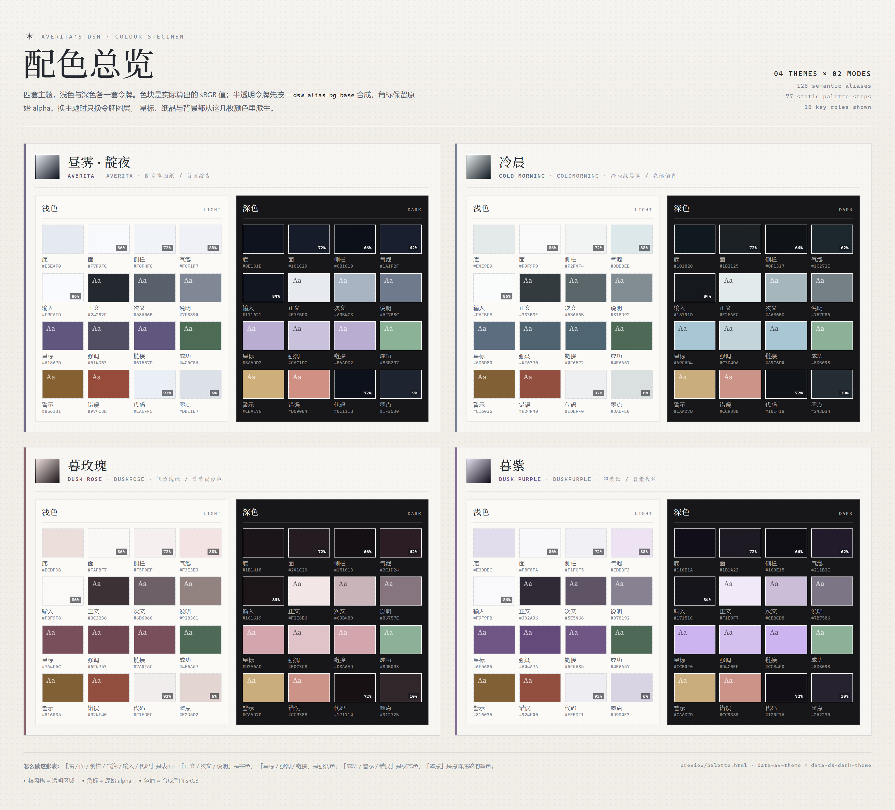](preview/palette-themes.png)

| 主题 | 浅色 · 底 / 正文 / 星标 | 深色 · 底 / 正文 / 星标 |
|---|---|---|
| 昼雾 · 靛夜 | `#E5EAF0` / `#24282F` / `#61567D` | `#0E131E` / `#E7EBF0` / `#BAADD2` |
| 冷晨 | `#E4E9E9` / `#333B3E` / `#5D6D80` | `#101820` / `#E2EAEC` / `#A9C6D4` |
| 暮玫瑰 | `#ECDFDB` / `#3C3236` / `#7A4F5C` | `#1B1418` / `#F2E6E6` / `#D3A6AD` |
| 暮紫 | `#E2DDEC` / `#302A36` / `#6F5685` | `#110E1A` / `#F1E9F7` / `#CCB4F0` |

> 面 / 侧栏 / 气泡 / 输入 / 代码 / 墨点带 alpha；表里只列不透明的底、正文与星标。主题文件在 `src/tokens.js` 与 `src/themes/`。

### 主要内容

按主界面六块整理：侧栏与品牌、会话与装饰、输入框、新会话首屏、设置 → 主题、背景。首屏用开头的实机八张，其余都用预览壳；壳的字体、间距与实机有差异，看配色与比例即可。

#### 侧栏与品牌

<a href="preview/content-shell/sidebar.png">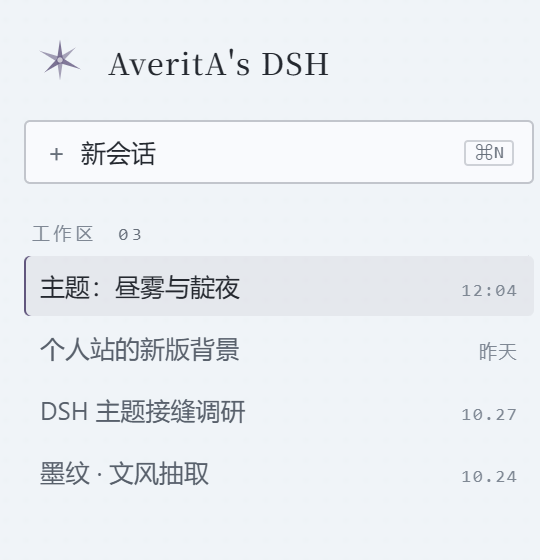</a>

星标是 32px 三轴正交六芒星，字标默认衬线 `AveritA's DSH`；留空只留星标。

#### 会话与装饰

| 纸品（浅色） | 星芒（深色） |
|---|---|
| <a href="preview/content-shell/conversation-paper.png">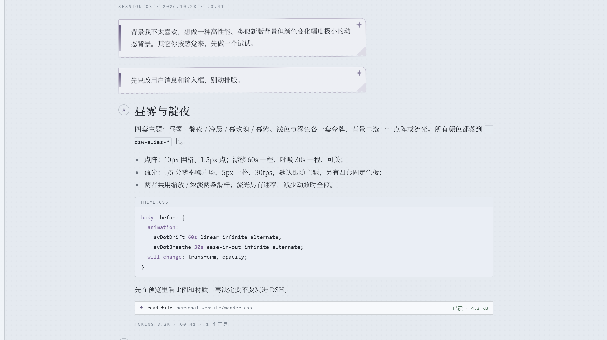</a> | <a href="preview/content-shell/conversation-star.png">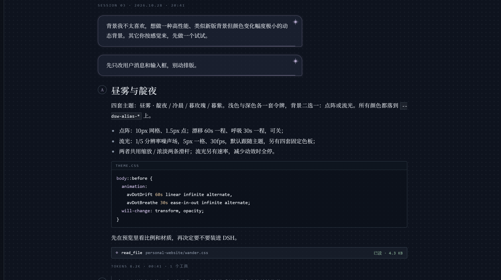</a> |

纸品：左缘书签带、右上星章、右下折角、底缘齿孔；星芒：右上 8 角星 + 底缘光边，圆角 14px。

#### 输入框

| 纸品 | 星芒 |
|---|---|
| <a href="preview/content-shell/composer-paper.png">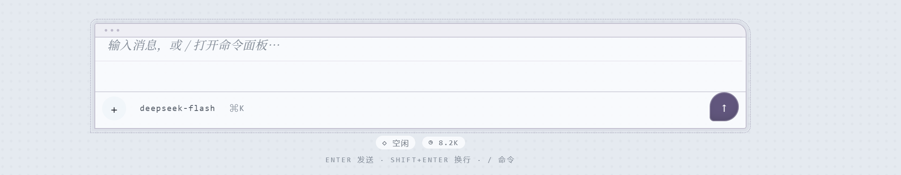</a> | <a href="preview/content-shell/composer-star.png">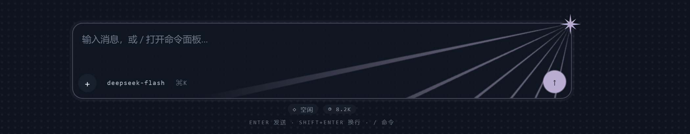</a> |

纸品给 15px 信头窄带、三枚装订孔、票根虚线与横格线；星芒给右上角纯色星、放射光束与聚焦放大。

#### 新会话首屏

四套主题的实机首屏见开头八张；`conversation.hero.brand.mark` 换成同一颗星，标题可在「设置 → 主题 → 新会话首屏」改。

#### 设置 → 主题

<a href="preview/content-shell/settings.png">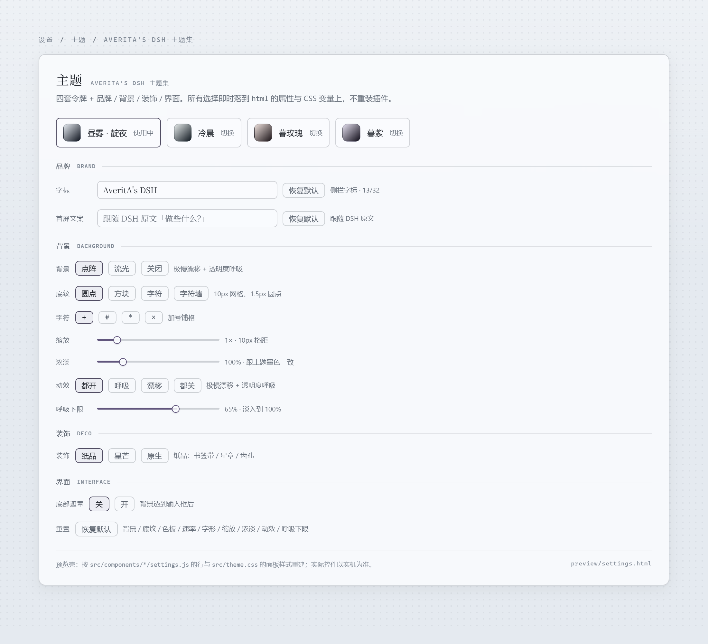</a>

四张主题卡 + 每个组件一个模块（品牌字标 / 新会话首屏 / 背景 / 点阵底纹 / 流光背景 / 装饰与星形 / 输入框底衬），空模块自动收起。这张是按 `src/components/*/settings.js` 的行与 `src/theme.css` 的面板样式重建的预览壳，实际控件以实机为准；**截图与 `preview/settings.html` 还是分组版旧图**，模块版待重截。

#### 背景五形

<a href="preview/content-shell/backgrounds.png">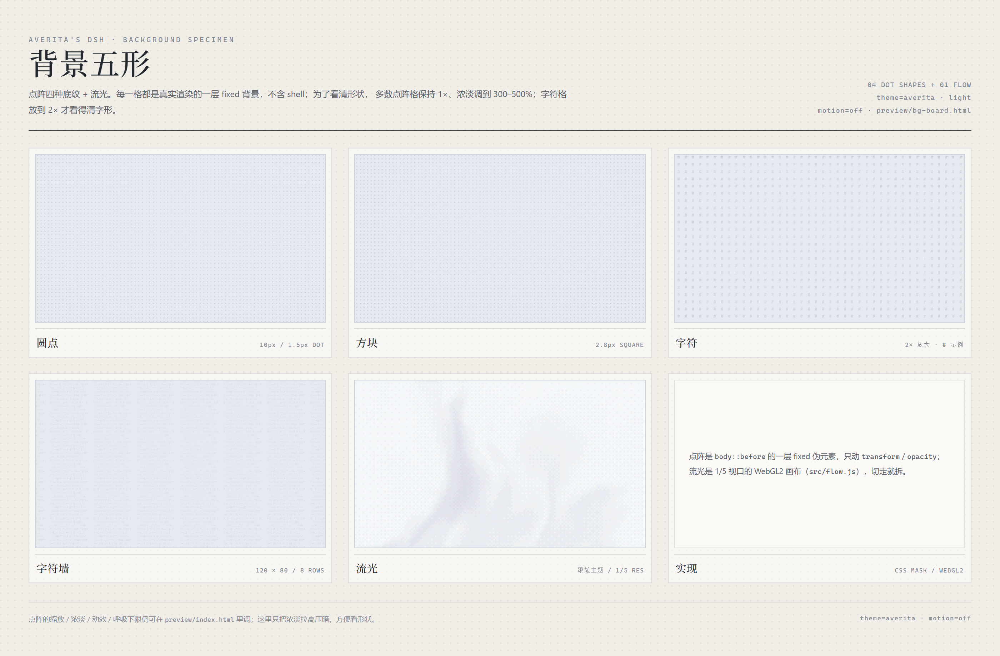</a>

四格点阵为了看清形状把浓淡调到 300–800%、字符格放到 2×；默认都是 100% / 1×。打开 [`preview/bg-board.html`](preview/bg-board.html) 可单独看。

## 组件化复用

CSS 按组件拆在 `src/components/`，构建按 `manifest.js` 的顺序拼进 `client.js`。每个目录有两到三件：`style.css`（有视觉组件才有）、`settings.js`（有设置行才有）、`README.md`；README 固定写四栏：**挂什么属性、读写什么变量、存什么、依赖宿主哪些选择器**。

| 组件 | 文件 | 挂什么 | 变量 |
|---|---|---|---|
| 新会话首屏 | `src/components/hero/style.css` | `data-av-hero-text` / `-empty` | `--av-hero-text` / `--av-mark` |
| 点阵底纹 | `src/components/dots/style.css` | `data-av-dots` / `-glyph` / `-motion` | `--av-space` / `--av-dot` / `--av-scale` / `--av-depth` / `--av-breathe-min` |
| 流光背景 | `src/components/flow/style.css` | `data-av-bg="flow"` / `data-av-flow-palette` / `data-av-flow-invert` | `--av-flow-0..3` / `--av-flow-glow` |
| 位移动效 | `src/components/motion/style.css` | 无 | 无（用宿主 `--ds-transition-*`） |
| 纸品装饰 | `src/components/paper/style.css` | `data-av-deco="paper"` | `--av-mark` 及派生的线 |
| 星芒装饰 | `src/components/star/style.css` | `data-av-deco="star"` / `data-av-star` | `--av-mark` / `--av-star-*` |
| 输入框底衬 | `src/components/composer/style.css` | `data-av-fade="on"`（开；默认不挂 = 关） | 无（只摘宿主背景） |

拿单个组件三步：复制它的 `style.css` → 在 `<html>` 挂对应属性 → 装了别的主题就把文件开头的兜底块删掉。没有设置面板也能用，属性手写即可；更多约定见 [`src/components/README.md`](src/components/README.md)。

`backdrop/`、`deco/` 与 `brand/` 只有设置行、没有 CSS：前者管背景 / 缩放 / 浓淡，后者管装饰 / 星形与品牌字标；`hero/` 有首屏标题与徽章的 CSS，以及首屏文案模块。

组件保持**未分层**：DSH 宿主 CSS 没有 `@layer`，分层里的普通声明会输给未分层声明（不管选择器多具体），主题要覆盖宿主就不能进层。

## 背景是怎么动起来的

背景二选一，落成 `html[data-av-bg="flow"|"off"]`（不挂属性 = 点阵）。两者互斥，切走就拆，不常驻。

### 点阵

```
html            底色（--av-space，按主题/深浅换）
body::before    默认颗粒：10px 网格、1.5px 圆点；极慢漂移 + 呼吸
html[data-av-dots="square"] body::before
                方块：同一网格、2.8px 方块（SVG 遮罩 + 渐隐遮罩相交）
html[data-av-dots="char"] body::before
                字符：同一网格、一个等宽字符（+ / # / * / ×）
html[data-av-dots="wall"] body::before
                字符墙：120×80 一块、8 行密排符号
--av-scale      缩放：遮罩 tile 一起缩放，0.5–4×（默认 1）
--av-depth      浓淡：墨色 alpha 乘一个倍数，30%–400%（默认 100%）
--av-breathe-min 呼吸下限：谷底不透明度，0–100%（默认 65%）
html[data-av-motion="breathe"|"drift"|"off"]
                动效：只呼吸 / 只漂移 / 全停；不挂属性 = 都开
```

- 只有一层 fixed 伪元素，动的是 `transform` / `opacity`：60s 漂移一程（±64 / ±36px 乘缩放，linear，往返 120s），30s 呼吸一程（`--av-breathe-min` → 1，往返 60s）。没有 canvas、没有颜色变化。
- 四种颗粒都是 SVG 遮罩，再和中心渐隐遮罩用 `mask-composite: intersect` 相交；颜色仍取 `--av-dot`（填充色给，遮罩只管形状），所以换主题 / 深浅自动跟。字符 / 符号走 SVG `<text>`，字号按墨量调过，和圆点、方块同一档深浅；字符墙整体 `fill-opacity` 压过半，比圆点还淡一点。
- 缩放只改遮罩 tile 的尺寸（`mask-size`），漂移幅度和 `inset` 余量都跟着缩放走；浓淡把 `--av-dot` 的 alpha 乘一个倍数（`rgb(from … / calc(alpha * var(--av-depth)))`），不碰主题令牌。两者都不动 DOM、不重装插件。
- `data-av-motion` 只重写动画列表：`breathe` 只留呼吸、`drift` 只留漂移、`off` 直接 `animation: none`；不挂属性即两样都开。品牌星和 UI 过渡不受这一项影响。
- 呼吸下限默认 65%，可调到 0（谷底完全淡出）或 100%（没有呼吸幅度）。浅色墨色只有 5.5% alpha，边缘实际只在 3.6%–5.5% 之间变，中心渐隐还要再减半，默认很淡；想看清可把浓淡拉到 200% 以上、把下限压到 0，或选「呼吸」排除漂移干扰。
- 窗口失焦时 `data-av-idle` 暂停动画；系统 `prefers-reduced-motion` 直接停住，设置面板会在「动效」旁提示「系统已减少动效」。

### 流光

```
html[data-av-bg="flow"] body::before
                点阵整层不画，位置让给 canvas.av-flow
canvas.av-flow  1/5 视口分辨率（1080p 约 384×216），5px 一格像素放大
--av-flow-0..3  色板四阶：底 / 暗面 / 光带 / 亮芯（CSS 给，JS 读；默认可从 --av-space / --av-mark 混出）
--av-flow-glow  亮芯强度；浅色收着，深色放开
--av-scale      流光下当场的缩放（0.5–4×）
--av-depth      流光下当画布不透明度（30%–400% → 0.12–0.86）
速率            0.2–2.5×，只乘时间步长（默认 1×）
```

- 场来自个人站 `src/scripts/wander/light.js` 的 `field()`：两次域扭曲、每层 5 次 fbm，映射到 4 档色板，再量化到 26 阶并叠 4×4 Bayer 抖动。站点自己的三条斜缝、夜色池、塌缩圈、风痕、天气与镜头没有搬。
- 画布只有视口的 1/5：1080p 下每帧约 8.3 万片元、每像素一遍场，对 GPU 是零头；代价主要是常驻刷新（锁 30fps）和首次编译着色器。检测到 SwiftShader / Basic Render Driver 这类软件渲染就不建画布，回退点阵。
- 色板默认**跟随主题**：四阶由 `color-mix(in srgb, var(--av-space) …, var(--av-mark) …)` 混出，换主题 / 切深浅自动跟，不会和界面撞色。另有雾蓝 / 暮紫 / 青灰 / 暖沙四套固定色板，各带浅深两版；切换只改 `html[data-av-flow-palette]`，画布下一帧重新取色，不重建上下文。
- 明暗默认**反转**：场里大部分面积落在前两档，所以第 0 档决定整页明暗。浅色反转时 0 档是纸白、深色只落在第 2/3 档的窄带上，整页不会被压成一块灰；`html[data-av-flow-invert="off"]` 回到旧写法（0 档从纸色往下压，白带再提亮）。深色两档一样——底色本来就是场底。
- `flow.js` 读 `--av-flow-*` 时先用隐藏探针把 `color-mix(...)` 解析成 `color(srgb …)` 再解析；固定色板仍走原来的十六进制 / `rgb()` 路径。
- 窗口隐藏 / 系统减少动效时停帧；减少动效只画一帧静态。切到点阵或关闭时画布整个拆掉、上下文一起丢。

- 外壳透明度：DSH 0.2.1-rc.3 的 AppFrame / centerCol / ConversationRoot 各自用 `--dsw-alias-bg-base` 铺满，主题用 CSS Modules 稳定后缀 + `:has` 把三处底色置空，背景才透出来。

## 品牌字标（设置 → 主题）

设置 → 主题里「品牌字标」与「新会话首屏」是两个模块。「字标」输入框实时改 `sidebar.brand.name` 里的文字，默认衬线 `AveritA's DSH`，最多 32 字；换行 / 制表符会折成空格，选择存在 localStorage 的 `<plugin-id>:wordmark`。

- 输入框留空（或只有空白）时整段文字不渲染，只留星标；旁边「恢复默认」把默认字标写回去。
- 字标只走 React 状态，不挂 `data-av-*` 属性；侧栏 `sidebar.brand.name` slot 订阅状态重渲染，切换主题 / 深浅不受影响。
- 自定义文字过长时侧栏按 `text-overflow: ellipsis` 省略，不会把 logo 挤走；完整文字在 `title` 里。

## 新会话首屏

首屏（没有会话的空态）把 DSH 的动画鱼换成左上角同一颗星，并隐藏标题右侧的「预览版」徽章；标题可在**设置 → 主题 → 新会话首屏**里改。

- **图标**：`conversation.hero.brand.mark` single slot，`HeroMark` 与侧栏 `BrandMark` 共用 `projectStar()`；34px、颜色 `--av-mark`。鼠标移入 / 移出各绕 z 轴转 90°，累计不回位；系统减少动效时静止。
- **文案**：宿主没有文案 slot，标题写死在 `t("hero.headline")`。主题用 `html[data-av-hero-text]` + `--av-hero-text` 隐藏原文字，`::before { content: var(--av-hero-text) }` 替换；不碰 React，hover 重渲染不会冲掉。`html[data-av-hero-empty]` 时整段标题不渲染，只留星标。
- **默认**：跟随 DSH 原文（不写键）。输入即替换；清空只留星标；「恢复默认」回到原文。存在 `<plugin-id>:hero-text`，上限 40 字。
- **徽章**：`_previewBadge` 无条件隐藏；要恢复删 `src/components/hero/style.css` 第一条规则。
- **结构依赖**：`_headline` / `_fishHitbox` / `_titleGroup` / `_previewBadge`（ui-conversation 0.2.1-rc.3 的 CSS Modules 稳定后缀）。结构变了，标题与徽章回退原生，图标 slot 不受影响。

## 背景（设置 → 主题）

「背景」模块三选一：**点阵 / 流光 / 关闭**；缩放 / 浓淡也在同一个模块里，点阵与流光各自一个模块，按选择出现。

### 点阵

- **底纹**：圆点（默认）/ 方块（2.8px）/ 字符（选完再选字形 **+ / # / * / ×**，默认加号）/ 字符墙（8 行密排代码符号）。
- **缩放**：0.5–4×，步进 0.1，默认 1；格距 5–40px（字符墙 60×40 到 480×320）。颗粒大小、格距与漂移幅度一起变。
- **浓淡**：30%–400%，步进 5%，默认 100%，乘在墨色 alpha 上；深色主题的墨色本来就比浅色亮一档，按需微调即可。
- **动效**：都开（默认）/ 呼吸 / 漂移 / 都关，只控制背景那一层，选择存在 `<plugin-id>:motion`。
- **呼吸下限**：0%–100%，步进 5%，默认 65%；谷底不透明度，0 = 完全淡出，100 = 没有呼吸幅度。只在动效为「都开 / 呼吸」时出现，选择存在 `<plugin-id>:breathe`。

### 流光

- **明暗**：反转（默认）/ 不反转，只影响浅色；反转时白做底、色斑落在光带上，不反转是底色下沉、白带提亮。挂在 `html[data-av-flow-invert]`，选择存在 `<plugin-id>:flow-invert`，深色下两档看不出差别。
- **色板**：跟随主题（默认）/ 雾蓝 / 暮紫 / 青灰 / 暖沙，浅深各自动切，选择存在 `<plugin-id>:flow`。跟随主题时四阶由当前主题的 `--av-space` / `--av-mark` 混出；固定色板是手选值，不跟主题变。
- **速率**：0.2–2.5×，步进 0.1，默认 1×；只乘时间步长，不动别的参数，选择存在 `<plugin-id>:speed`。
- **缩放**：场的缩放，0.5–4×，默认 1。
- **浓淡**：画布不透明度，30%–400% 映射到 0.12–0.86，默认 0.62。
- 系统减少动效时只画一帧，设置面板会提示「流光静止」；没有 WebGL2 时切不过去，面板会说明并留在点阵。

- 关闭背景时下面几排自动收起。
- 末尾「重置 → 恢复默认」把背景 / 底纹 / 色板 / 明暗 / 速率 / 字形 / 缩放 / 浓淡 / 动效 / 呼吸下限一键回默认，主题与装饰不动。

选择存在 localStorage 的 `<plugin-id>:wordmark` / `:bg` / `:dots` / `:flow` / `:flow-invert` / `:speed` / `:glyph` / `:scale` / `:depth` / `:motion` / `:breathe` / `:fade`（速率 / 缩放 / 浓淡 / 呼吸下限存乘数，1 = 1× / 1× / 100% / 100%），落成 `html[data-av-bg="flow"|"off"]`、`html[data-av-dots="square"|"char"|"wall"]`、`html[data-av-flow-palette="theme"|"mist"|"dusk"|"jade"|"amber"]`、`html[data-av-flow-invert="on"|"off"]`、`html[data-av-glyph="plus"|"hash"|"star"|"cross"]`、`html[data-av-motion="breathe"|"drift"|"off"]`、`html[data-av-fade="on"]`；缩放 / 浓淡 / 呼吸下限直接写成 `html` 行内的 `--av-scale` / `--av-depth` / `--av-breathe-min`，不再挂 data 属性；「都开」把 `data-av-motion` 摘掉，选「圆点」把 `data-av-dots` 摘掉，选「点阵」把 `data-av-bg` 摘掉，选「关」把 `data-av-fade` 摘掉。切换只改属性 / 变量；点阵不动 DOM，流光按需建 / 拆画布；字符缺字形时 CSS 退回加号，不会把整块涂实。

首屏文案存在 `<plugin-id>:hero-text`：键不存在 = 跟随 DSH 原文，空串 = 只留星标，其余 = 替换标题；落成 `html[data-av-hero-text]` / `html[data-av-hero-empty]` 与行内 `--av-hero-text`。

## 界面（设置 → 主题）

「输入框底衬」是主题里的一个模块。

### 底部遮罩

- **关（默认）**：摘掉 DSH 在会话有内容时给 `composerSeat` 铺的渐隐底衬，点阵 / 流光透到输入框后；输入卡自己的底色不变。
- **开**：保留宿主原来的效果——顶部 36px 从透明渐隐到 `--dsw-alias-bg-base`，往下纯色，输入框周围不露背景。
- 选择存在 `<plugin-id>:fade`，落成 `html[data-av-fade="on"]`；关时不挂属性。关掉后滚动内容可能从输入框底部状态栏附近透出一点，这是去掉底衬的连带效果。

## 配套插件

主题只做视觉。两个行为插件是**独立包**，按需单独安装，谁都不依赖主题：

| 插件 | 做什么 | 说明 |
|---|---|---|
| [`dsh-yet-another-slider-thingy`](https://github.com/Traveritas/dsh-yet-another-slider-thingy) | 把 composer 的模型位换成「模型行 + 思考强度滑条」，档位与提交走宿主同一份模型目录 | 独立仓，安装与限制见它自己的 README |
| `dsh-status-minimal` | 把「运行中」那一行换成可轮换文案（打字机 / 可选渐变 / 已用时） | 独立仓，自带设置分区 |

不装时主题保持 DSH 原生行为；两者的设置互不重叠（主题在「设置 → 主题」，滑条在「设置 → 思考强度」，状态文案在「设置 → 状态文案」）。

## 用户消息与输入框

同一批部件有两套装饰，在「设置 → 主题」下方切换：**纸品 / 星芒 / 原生**。默认纸品，选择存在 localStorage 的 `<plugin-id>:deco`，落成 `html[data-av-deco="paper"|"star"]`；选「原生」就把属性摘掉，退回 DSH 原样。切换只改这一个属性，不动 DOM、不重装插件。

运行中插话（steering）的用户消息，以及它落盘前的回显气泡，与普通用户消息共用同一套装饰：DSH 分别把它们挂在 `data-chat-flow-kind="steering"` 与 `data-pending-steering` 下，选择器已一并覆盖。

星形（只在星芒装饰下出现）默认 **罗盘**，另有针芒可选，存在 `<plugin-id>:star`，落成 `html[data-av-star="a"|"b"]`。

| 部件 | 命中点 | 纸品（paper） | 星芒（star） |
|---|---|---|---|
| 用户消息 / 插话 | `:is([data-chat-flow-kind="user"], [data-chat-flow-kind="steering"], [data-pending-steering]) [class*="_bubble"]:not([role="tooltip"])` | 左缘书签带、右上星章、右下折角、底缘齿孔，−0.3° 微斜 | 右上 8 角星（带光晕）+ 底缘光边，圆角 14px |
| 输入框 | `[data-composer-seat] [class*="_card"]` | 15px 信头窄带（三枚装订孔）、票根虚线、输入区横格线 | 右上角纯色星（罗盘 / 针芒两形）+ 放射光束，聚焦时放大一成 |
| 发送键 | `[data-composer-seat] [class*="_primary"]` | 缺角圆章，hover 转 −6° | 一圈光，hover 撑开 |

- 装饰线不写死色号：`--av-line` / `--av-line-soft` / `--av-wash` 三枚派生变量从 `--av-mark` 用 `color-mix` 算，换主题自动跟；深色单独压/提一档（`html:has(body[data-ds-dark-theme])`）。
- 纸品：输入卡 `padding-top` 加到 15px 给信头窄带让位；横格线周期 24px 对齐 DSH 行高，改字号设置时会有轻微错位。气泡底缘齿孔用 `mask-image`，会连 `box-shadow` 一起裁掉，所以阴影改用 `filter: drop-shadow()`。
- 星芒：星只做**纯色剪影**——不转、不加光晕、不做内部渐变，靠形状说话；形状由 `html[data-av-star]` 选：`a` 罗盘刻星（四长四短，端正）、`b` 针芒（四根长针 + 极短刺，更利），在「设置 → 主题 → 装饰与星形」里切。射线是 `repeating-conic-gradient`（每 12° 一束）+ `radial-gradient` 遮罩，浅色压到只当质感、深色提亮当光束。两套装饰共用同一批选择器，靠 `html[data-av-deco]` 分流，互斥。

## 主题文件与生成

- **昼雾 · 靛夜**：`src/tokens.js`（唯一手写令牌表）；主题变量在 `src/themes/averita.js`。
- **冷晨 / 暮玫瑰 / 暮紫**：`src/themes/*.js`，由 `scripts/gen-themes.mjs` 从 averita 的明度、透明度结构派生色相族，再覆盖 label/link/brand 与底色。
  - 直接手改这三个文件后 **不要再跑** `gen-themes.mjs`（会覆盖）；要改派生规则就去改脚本。
  - `暮紫` 的明暗锚点取自流光「暮紫」色板：浅色 `#e2ddec`、深色 `#110e1a`，强调色 `#6f5685` / `#ccb4f0`。
- **静态色板**：`scripts/static-base.json` 是从 DSH base.css 提取的 77 个 `--dsw-static-*`；`scripts/static-derive.mjs` 定义派生规则（neutral / bluish 收向主题中性色，blue / deepseek 收向强调色，red / green / amber 保色相并按背景对比度≥4.6:1 排明度），`scripts/gen-static.mjs` 写出 `src/themes/static/<id>.js`。四套主题的键集合一致（build 会断言）。
- **加第五套**：复制一份 `src/themes/*.js`，在 `scripts/build.mjs` 的 `themeFiles`、`scripts/gen-static.mjs` 与 `scripts/gen-themes.mjs` 里登记，并在 `preview/index.html` 加一个按钮。
- **组件**：`src/components/<id>/` 的 CSS 由 manifest 拼到 `theme.css` 之后，`settings.js` 由 build 原样内联进 `COMPONENT_SETTINGS`，**一个组件就是设置里的一个模块**（标题取 manifest `label`，顺序取 `settings.order`，空模块不渲染）。加组件要同时改 manifest（有 CSS 还要补三个预览页的 `<link>`），smoke 会查模块表、行序与设置注册表。

## 构建与自检

```powershell
node scripts/build.mjs      # src/theme.css + src/components/* -> client.js（内联令牌 / 组件 CSS / 设置片段 / flow.js）+ preview/tokens.css
node scripts/smoke.mjs      # 离线冒烟：令牌成对、组件 CSS / 设置片段齐全、样式装卸、slot 注册（品牌 / 首屏 / 设置分区）、可见性暂停、字标 / 首屏文案 / 底纹 / 字形 / 缩放 / 浓淡 / 动效 / 呼吸下限 / 底衬往返
node scripts/gen-static.mjs  # 可选：重派生静态色板（覆盖 src/themes/static/*）
node scripts/gen-themes.mjs  # 可选：重派生冷晨/暮玫瑰/暮紫基础令牌（覆盖手改，静态色板保留）
node scripts/derive-slider-palettes.mjs  # 可选：输出思考强度滑条的四套主题配色（静态 hex，粘到滑条仓的 BUILTIN_PALETTES）
```

`client.js` 是产物，不要手改；改 `src/`。

## 已知限制

- **实机验收范围**：已在 DSH 0.2.1-rc.3 / Windows 上确认浅色纸品与深色星芒（顶部截图）；冷晨、暮玫瑰与暮紫的深色是派生夜色，暮紫目前只在预览壳验收，实机仍建议自看一遍。
- **静态色板是派生值**：blue / deepseek 在冷晨、暮玫瑰、暮紫里会跟强调色走（暮玫瑰的 info 蓝会变成玫瑰色，暮紫的 info 蓝会变成紫色）；若想保留信息蓝，把 `static-derive.mjs` 里 `blue` / `deepseek` 的映射拿掉重跑即可。静态色板的 light / dark 值对 red/green/amber 是分开排的（按对比度），所以状态色在两种模式下会有轻微差异。
- **新回复动画靠结构选择器**：`[data-chat-turn]:not(:has(~ [data-chat-turn]))` 只认“最后一个 turn”，要求 turn 是同级兄弟；DSH 改结构时会静默失效。侧栏折叠的 300ms 过渡也依赖 frame 的 grid 过渡。
- **纸品装饰也钉在结构上**：用户消息靠 `data-chat-flow-kind="user"|"steering"`（回显再补 `data-pending-steering`）+ `_bubble` 后缀，输入框靠 `data-composer-seat` + `_card`/`_primary` 后缀。DSH 改这两处，装饰会整段失效（功能不受影响，回退成原生外观）。用户气泡的选择器要带 `:not([role="tooltip"])`：宿主 Tooltip 的类名是 `_bubble_*` 且就挂在消息内部，被命中会从 `position: fixed` 变成 `relative`，把复制按钮那排撑宽、hover 时来回跳。
- **底部遮罩也钉在 `[data-composer-seat]` 上**：DSH 改这个属性、或把渐变挪到别的层时，开关会静默失效、回到宿主原样。关掉后只摘 seat 自己的背景；滚动内容可能从输入框底部状态栏附近透出一点，输入卡 `_card` 的底色不受影响。
- **字标只换文字**：品牌位只覆盖 logo 右侧文字，星标仍是主题自带的；字标上限 32 字，超长由侧栏省略，留空只留星标。
- **首屏文案钉在结构上**：标题替换依赖 `_headline` / `_titleGroup` / `_fishHitbox` / `_previewBadge` 四个 CSS Modules 后缀；DSH 改结构时标题与徽章回退原生，图标 slot 仍会替换。文案上限 40 字，超长在首屏内换行。
- **思考强度滑条已拆成独立插件**：[`dsh-yet-another-slider-thingy`](https://github.com/Traveritas/dsh-yet-another-slider-thingy)，主题不再内联该座位；它的转发限制与版本契约写在该仓 README。
- **组件只拆到 CSS + 设置模块**：单独复制 `src/components/<id>/style.css` 能用，但没有设置面板（属性手写即可）；选择器、localStorage 与流光画布的生命周期仍在 `src/client.template.js`。
- **颗粒遮罩依赖 `mask-composite`**：四种颗粒与渐隐两层遮罩相交需要 Chromium 120+ / Safari 15.4+；更老的内核会退化成两层叠加，颗粒照旧、中心渐隐失效，不影响可用性。字符 / 符号走 SVG `<text>`，字体栈是 Consolas / Segoe UI Symbol，换机器字形会有细微差别。
- **浓淡依赖相对色语法**：`rgb(from var(--av-dot) …)` 需要 Chromium 119+ / Safari 16.4+；不支持的内核退回主题原色，浓淡滑杆静默失效，其余照旧。
- **流光要 WebGL2 + 硬件渲染**：SwiftShader / Basic Render Driver 这类软件渲染会被 `src/flow.js` 直接拒掉，切流光时回退点阵并在面板提示；切到流光会新建一个 WebGL 上下文，切走即丢。默认锁 30fps，窗口隐藏 / 系统减少动效时停帧。
- **流光固定色板仍是绝对的**：默认「跟随主题」不会撞色；手动切到雾蓝 / 暮紫 / 青灰 / 暖沙时是写死的四阶（明暗反转各一套浅色值），不随主题变，仍可能和某些主题不搭。色板的四阶在 `src/components/flow/style.css`（`--av-flow-0..3` / `--av-flow-glow`），5px 像素格与 30fps 在 `src/flow.js` 顶部。
- **「跟随主题」的流光依赖 `color-mix` 探针**：`flow.js` 会把 `color-mix(...)` 挂到隐藏探针上读计算值；Chromium 111+ 支持 `color-mix`，更老的内核读不到颜色时会退回默认色板。固定色板不受影响。
- **极端缩放会放大合成面积**：fixed 伪元素按缩放留漂移余量，4× 时约为视口面积的 2.5 倍；低端 GPU 上大面积遮罩 + 位移动画的合成开销会上升。这是放开上限的代价，觉得不划算就把上限收回去。
- **深色发送键对比偏弱**：输入框发送键用 `--dsw-alias-button-info-fill`（深色 `#baadd2`），DSH 前景写死 `#ffffff`，白字压在亮紫上约 1.7:1。要修得改深色令牌（`tokens.js` 的 info-fill），不是 CSS 能补的。
- **外壳选择器钉在 DSH 0.2.1-rc.3 的结构上**：`_frame` / `_centerCol` / `_root:has(_composerSeat)` 依赖 CSS Modules 局部名后缀；升级后若背景退回纯色，先更新那段。
- 主题切换写在插件自己的设置分区里（`settings.section`），不接管 DSH 的浅色/深色开关；切换的是“主题”，浅色/深色仍由 DSH 控制。
- DSH 原生窗口 chrome 只认 light/dark，深色窗外框仍是中性灰，和靛夜/冷晨/暮玫瑰/暮紫的底色有色相差。
- 正文/界面字体沿用 DSH 设置（当前 profile 是 Source Serif 4 + 霞鹜文楷）。想要个人站的文章感，建议把「正文字体」设为 `"Noto Serif SC", "Source Serif 4"`（装了 Noto Serif SC 时）。
- 预览壳里的字体回退与实际 DSH 不同，看截图时请忽略字形差异。

## License

MIT，见仓库根目录的 [LICENSE](LICENSE)。
